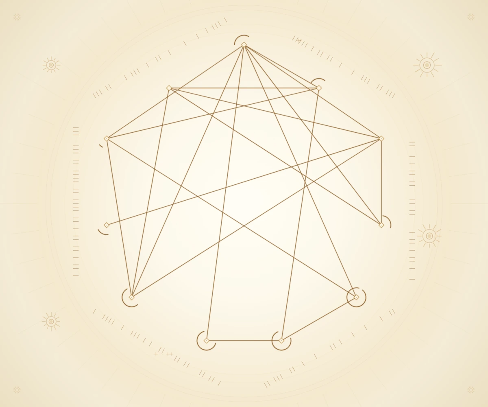

# Sigil

Offline Pathfinder 2e spell-sigil editor built with TypeScript and Canvas 2D.
Includes 1,400 spells, custom spell editing, 41 themes (6 surfaces,
4 traditions, and 31 traits), and PNG, transparent PNG, and spell-card
exports. No runtime dependencies or network connection are required.

Open [standalone.html](standalone.html) in a browser. See
Explanation in the top bar for the notation, mathematics, and worked examples.
Its source is [explanation.qmd](docs/explanation.qmd)
([rendered HTML](docs/explanation.html)).

## Gallery


Fireball uses the Fire trait theme, while Cornucopia pairs the Primal theme
with a semicircular base. Moonward and Tideglass are custom spells with
different attributes and drawing settings. All four sigils were exported from
Sigil with rank filtering turned off.

| Fireball · Fire | Cornucopia · Primal |
| --- | --- |
|  |  |
| **Moonward · Divine** | **Tideglass · Tattoo** |
|  |  |

- **Moonward:** rank 5, Divine, touch, 1 hour, light, spirit damage, emanation.
- **Tideglass:** rank 7, Primal, 60 feet, sustained, water, cold damage, cone.

## Development and verification

Use Node.js 22 (22.13 or newer) or 24+ and Quarto CLI 1.11.9.
The devcontainer installs Quarto automatically; on Debian/Ubuntu, run
`sudo sh .devcontainer/install-quarto.sh` to install the same pinned release.
Other platforms can use the [official Quarto installer](https://quarto.org/docs/get-started/).

```sh
npm ci
npm run dev
```

The development server runs at http://localhost:4173. Before submitting changes:

```sh
npm run format
npm run check
npm run build
```

`check` runs type checking, ESLint, Prettier verification, and automated tests.
`build` renders the QMD with embedded math libraries, then bundles the guide,
catalogue, and application into one offline HTML file. `npm run build:docs`
renders only the guide. `dev` also renders it before starting the server.
Rendering requires network access to download the pinned MathJax library;
the generated files need neither Quarto nor a network connection.
Do not edit generated files directly.

For browser tests, install Chromium with
`npx playwright install --only-shell chromium`, then run `npm run test:browser`.
See [Architecture](docs/ARCHITECTURE.md) for module contracts, controlled pixel
tests, and documentation-build instructions.

For GitHub Pages, select GitHub Actions as the publishing source. The
[workflow](.github/workflows/pages.yml) verifies, builds, and deploys `main`.

## AI use

Implementation was AI-assisted, primarily using GPT-6.1 Sol and DeepSeek V4,
especially for drawing code and HTML. The concept, mathematics, and notation
extensions are human-designed. Notation-generation code was written manually
and/or reviewed by humans.

## Licensing and credits

Sigil's original code is [GPL-3.0-or-later](LICENSE). The bundled Pathfinder
catalogue is not GPL-licensed: the [ORC License](LICENSES/ORC.pdf) applies
only to covered rules material and does not clear the mixed catalogue for
redistribution. See the [licensing notice](NOTICE.md),
[credits](docs/CREDITS.md), and [source index](docs/SPELL-SOURCES.md).
