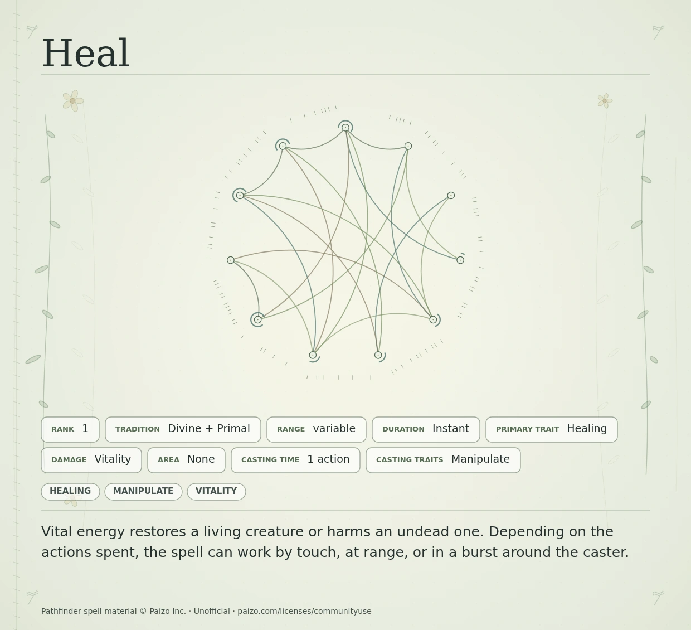
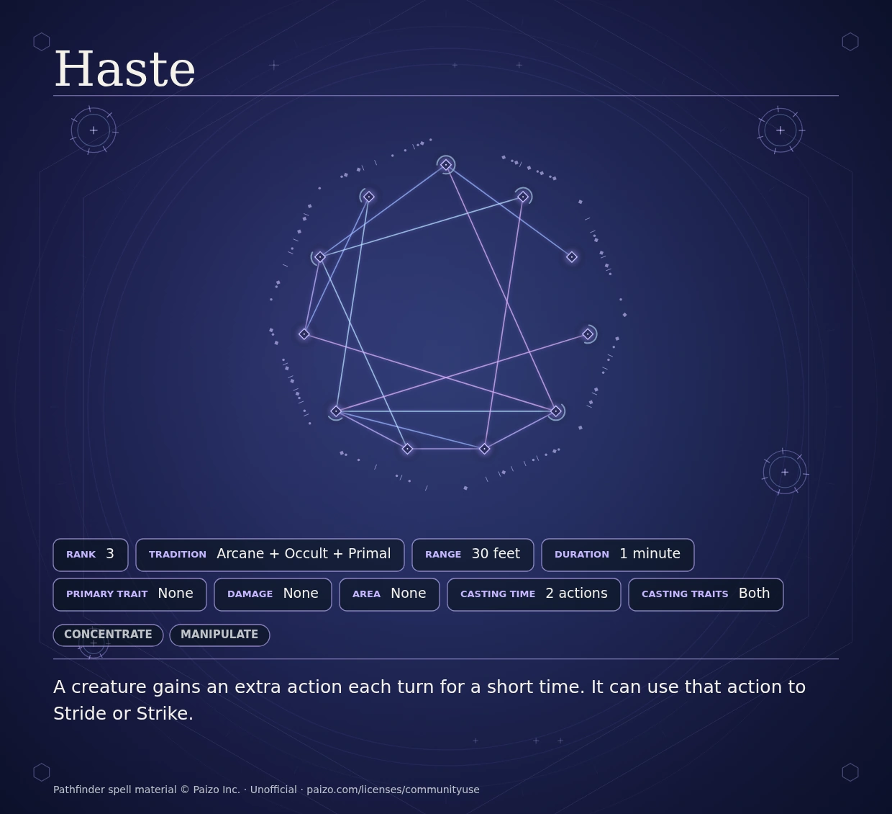

# Sigil

Turn Pathfinder 2e spells into sigils that encode their rules, not just
illustrate them. Each spell has a unique sigil.

Try the included sample spells, Moonward and Tideglass, or create your own.
Start with one of 41 themes
(6 surfaces, 4 traditions, and 31 traits), then customize colors, shapes,
ink, and ornaments to give each school, spell, or wizard a distinct style.
Export your sigil as a PNG, a transparent PNG, or a spell card.

**[Try Sigil offline](https://falknerdominik.github.io/sigil/standalone.html):**
Save the page as `standalone.html` and open it in your browser. See
**Explanation** in the app for how sigils work.

## Gallery


| Fireball - Fire | Cornucopia - Primal |
| --- | --- |
|  |  |
| **[Sunburst](https://2e.aonprd.com/Spells.aspx?ID=1707) - Divine** | **[Howling Blizzard](https://2e.aonprd.com/Spells.aspx?ID=1559) - Tattoo** |
|  |  |

### Spell cards

Sigil's spell-card export pairs the sigil with its attributes, traits, and an
editable description. Select a card to view it at full size.

| Electric Arc - Cantrip - Blueprint | Freeze Time - Rank 10 - Occult |
| --- | --- |
| [](docs/gallery/electric-arc-spell-card.webp) | [](docs/gallery/freeze-time-spell-card.webp) |
| **Heal - Rank 1 - Herbarium** | **Haste - Rank 3 - Arcane** |
| [](docs/gallery/heal-spell-card.webp) | [](docs/gallery/haste-spell-card.webp) |

## Development and verification

Sigil is built with TypeScript and Canvas 2D. To develop it, use Node.js
22.13+ (or 24+) and Quarto CLI 1.11.9. The devcontainer installs Quarto
automatically. To verify and build the public edition:

```sh
npm ci
npm run check:public
npm run build:public
```

Open `_site/standalone.html` to preview the public build. If you have the full
local development catalogue, `npm run dev`, `npm run check`, and `npm run build`
use it instead.
Building requires internet access to fetch MathJax; the resulting app runs
offline. See [Architecture](docs/ARCHITECTURE.md) for Quarto setup, build
details, browser tests, and GitHub Pages deployment.

## Licensing and credits

### Content & Licensing

Sigil's [application code](src/) is [GPL-3.0-or-later](LICENSE). The public
editor bundles only [original sample spells](data/sample-spells.json). The
development [spell.json](data/spell.json), its generated
[spell-data.js](data/spell-data.js), and the full local
[standalone.html](standalone.html) contain the mixed Pathfinder catalogue.
The GitHub Pages site serves the public build, not those development files.

Use each record's `source` (including page) and `nethysUrl`, together with the
[source index](docs/SPELL-SOURCES.md), to locate the original publication.
`legacy content` is an edition hint, not a license field. The original
publication determines which material is OGL Open Game Content or ORC Licensed
Material; neither is relicensed as the other.

See the [copyright notice](licenses/NOTICE.txt),
[OGL 1.0a and Section 15 notices](licenses/OGL-1.0a.txt),
[ORC license](licenses/ORC-LICENSE.txt),
[ORC attribution notice](licenses/ORC-NOTICE.txt), and
[Community Use notice](licenses/COMMUNITY-USE.txt). The
[licensing notice](NOTICE.md) summarizes the bundled notices; the [Credits](docs/CREDITS.md)
include official references and developer contact details.

## AI use

Implementation was AI-assisted, primarily using GPT-6.1 Sol and DeepSeek V4,
especially for drawing code and HTML. The concept, mathematics, and notation
extensions are human-designed. Notation-generation code was written manually
and/or reviewed by humans.
