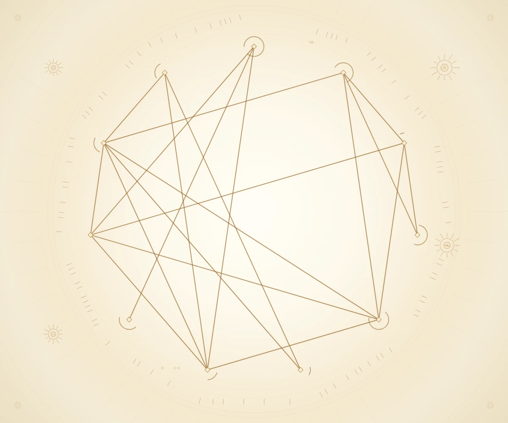
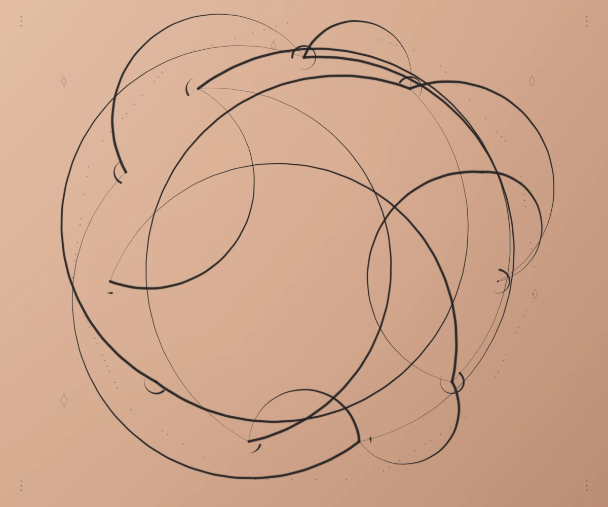
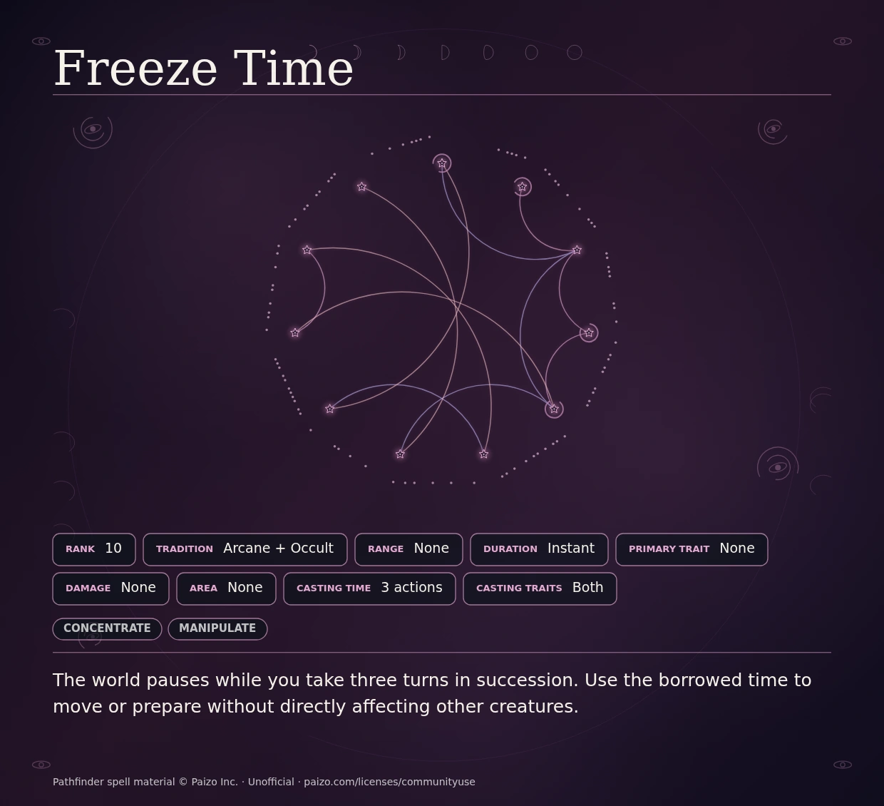

# Sigil

Turn Pathfinder 2e spells into sigils that encode their rules, not just
illustrate them. Each spell has a unique sigil.

Choose from 1,400 bundled Pathfinder 2e spells or create your own.
Start with one of 41 themes
(6 surfaces, 4 traditions, and 31 traits), then customize colors, shapes,
ink, and ornaments to give each school, spell, or wizard a distinct style.
Export your sigil as a PNG, a transparent PNG, or a spell card.

**[Open the Sigil editor](https://falknerdominik.github.io/sigil/)**

To use Sigil offline, save the page as `standalone.html` and reopen the saved
file in your browser. See **Explanation** for how sigils work.

## Gallery


| **[Fireball](https://2e.aonprd.com/Spells.aspx?ID=1530) - Fire** | **[Cornucopia](https://2e.aonprd.com/Spells.aspx?ID=1856) - Primal** |
| --- | --- |
|  |  |
| **[Sunburst](https://2e.aonprd.com/Spells.aspx?ID=1707) - Divine** | **[Howling Blizzard](https://2e.aonprd.com/Spells.aspx?ID=1559) - Tattoo** |
|  |  |

### Spell cards

Sigil's spell-card export pairs the sigil with its attributes, traits, and an
editable description. Select a card to view it at full size.

| Electric Arc - Cantrip - Blueprint | Freeze Time - Rank 10 - Occult |
| --- | --- |
| [](docs/gallery/electric-arc-spell-card.webp) | [](docs/gallery/freeze-time-spell-card.webp) |
| **Heal - Rank 1 - Herbarium** | **Haste - Rank 3 - Arcane** |
| [](docs/gallery/heal-spell-card.webp) | [](docs/gallery/haste-spell-card.webp) |

## Development and verification

Sigil is built with TypeScript and Canvas 2D. To develop it, use Node.js
22.13+ (or 24+) and Quarto CLI 1.11.9. The devcontainer installs Quarto
automatically. To verify and build the app:

```sh
npm ci
npm run check
npm run build
```

Open [standalone.html](standalone.html) to use the same build that GitHub Pages
publishes, or run `npm run dev` for local development.
Building requires internet access to fetch MathJax; the resulting app runs
offline. See [Architecture](docs/ARCHITECTURE.md) for Quarto setup, build
details and GitHub Pages deployment.

## Licensing and credits

Sigil's code is [GPL-3.0-or-later](LICENSE). See the [licensing notice](NOTICE.md)
for the separate Pathfinder terms, copyright notices, and credits. The editor's
**Licenses & Attribution** dialog includes the same documents offline.

## Support Sigil

Sigil is free and works offline. If you use it in your campaign, a coffee helps me maintain the editor and improve spell-card exports.

[](https://www.buymeacoffee.com/dominikfalkner)

## AI use

Implementation was AI-assisted, primarily using GPT-6.1 Sol and DeepSeek V4,
especially for drawing code and HTML. The concept, mathematics, and notation
extensions are human-designed. Notation-generation code was written manually
and/or reviewed by humans.
