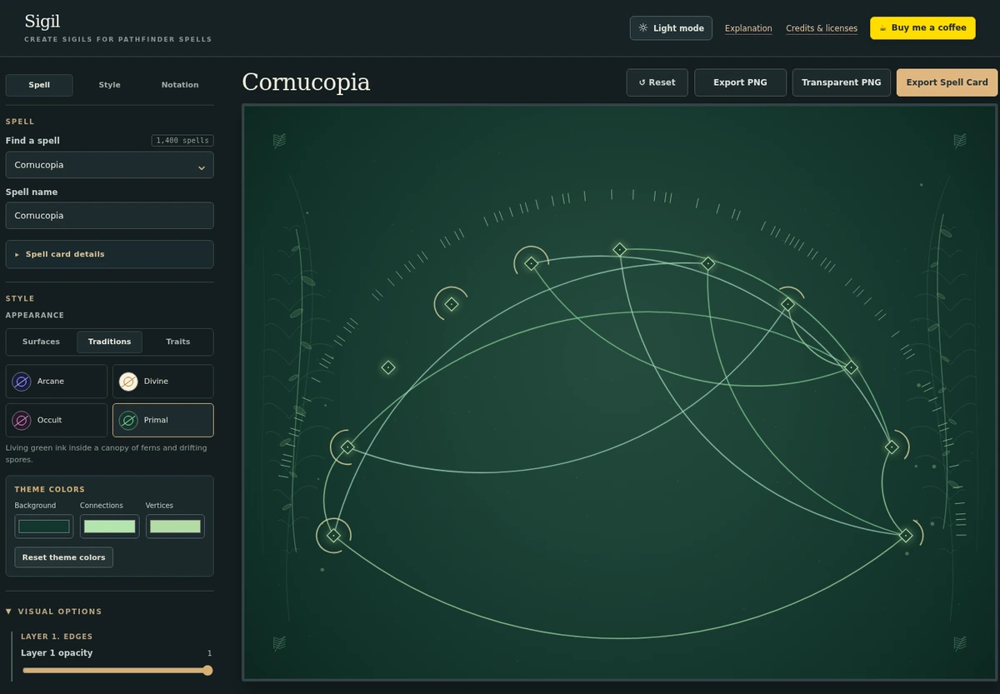
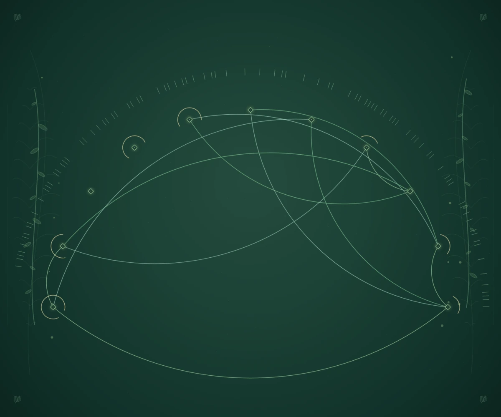
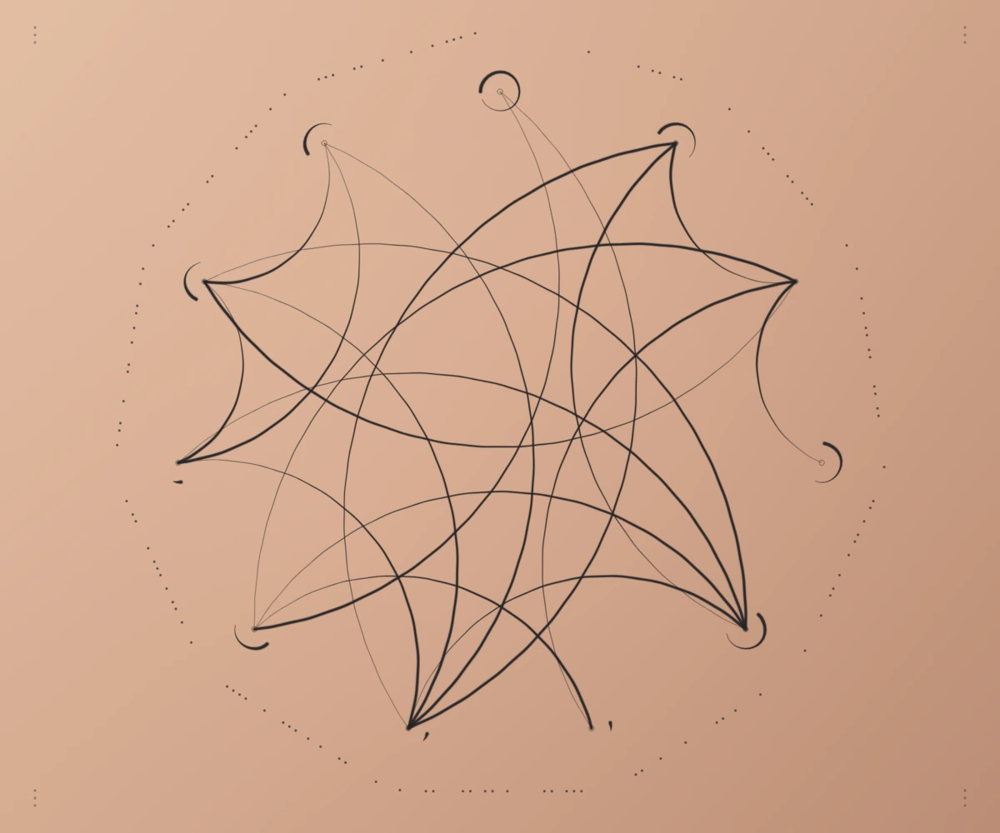
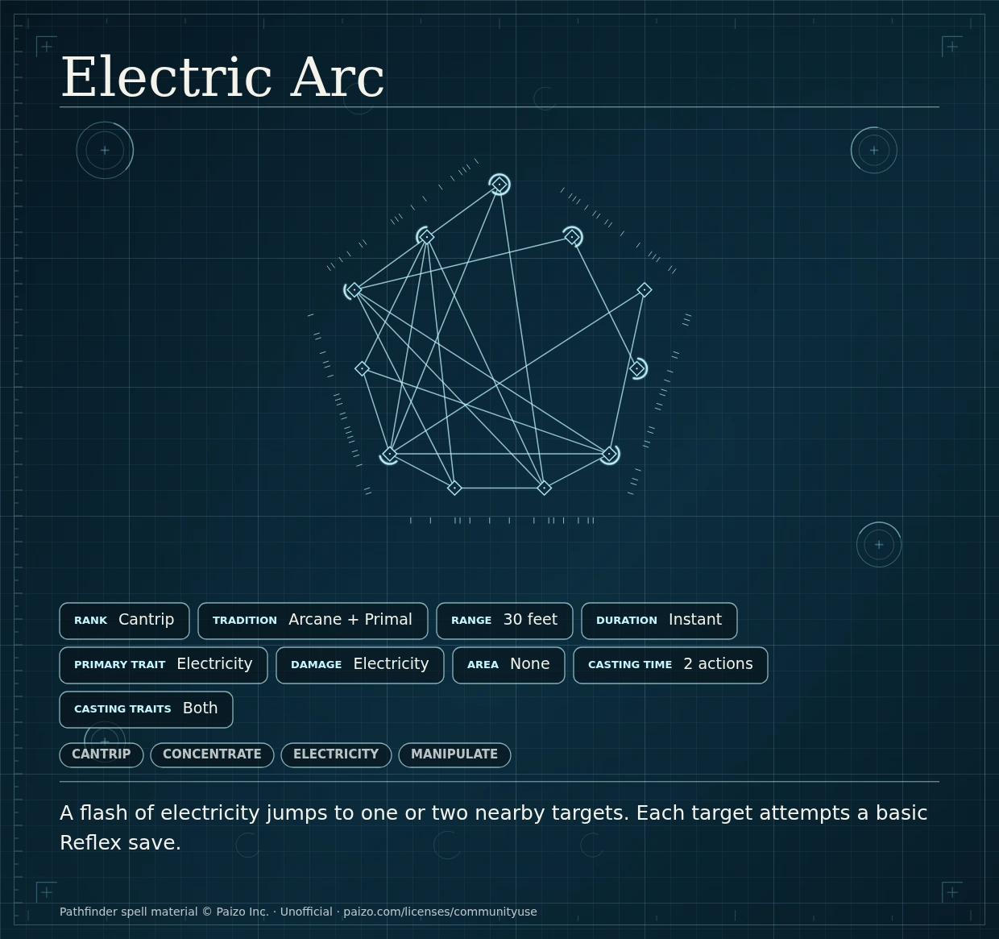

# Sigil

Turn Pathfinder 2e spells into sigils that encode their rules, not just
illustrate them. Each spell has a unique sigil.

Try the included sample spells, Moonward and Tideglass, or create your own.
Start with one of 41 themes
(6 surfaces, 4 traditions, and 31 traits), then customize colors, shapes,
ink, and ornaments to give each school, spell, or wizard a distinct style.
Export your sigil as a PNG, a transparent PNG, or a spell card.

Open the generated standalone file in your browser to use Sigil offline. See
**Explanation** in the app for how sigils work.

## Gallery



| Fireball - Fire | Cornucopia - Primal |
| --- | --- |
|  |  |
| **Moonward - Divine** | **Tideglass - Tattoo** |
|  |  |

### Spell cards

Sigil's spell-card export pairs the sigil with its attributes, traits, and an
editable description. Select a card to view it at full size.

| Electric Arc - Cantrip - Blueprint | Freeze Time - Rank 10 - Occult |
| --- | --- |
| [](docs/gallery/electric-arc-spell-card.webp) | [](docs/gallery/freeze-time-spell-card.webp) |
| **Heal - Rank 1 - Herbarium** | **Haste - Rank 3 - Arcane** |
| [](docs/gallery/heal-spell-card.webp) | [](docs/gallery/haste-spell-card.webp) |

## Development and verification

Sigil is built with TypeScript and Canvas 2D. To develop it, use Node.js
22.13+ (or 24+) and Quarto CLI 1.11.9. The devcontainer installs Quarto
automatically. To verify and build the public edition:

```sh
npm ci
npm run check:public
npm run build:public
```

Open `_site/standalone.html` to preview the public build. If you have the full
local development catalogue, `npm run dev`, `npm run check`, and `npm run build`
use it instead.
Building requires internet access to fetch MathJax; the resulting app runs
offline. See [Architecture](docs/ARCHITECTURE.md) for Quarto setup, build
details and browser tests.

## AI use

Implementation was AI-assisted, primarily using GPT-6.1 Sol and DeepSeek V4,
especially for drawing code and HTML. The concept, mathematics, and notation
extensions are human-designed. Notation-generation code was written manually
and/or reviewed by humans.

## Licensing and credits

Sigil's original code is [GPL-3.0-or-later](LICENSE). The bundled Pathfinder
catalogue is not GPL-licensed: the [ORC License](LICENSES/ORC.pdf) applies
only to covered rules material and does not clear the mixed catalogue for
redistribution. See the [licensing notice](NOTICE.md),
[credits](docs/CREDITS.md), and [source index](docs/SPELL-SOURCES.md).
