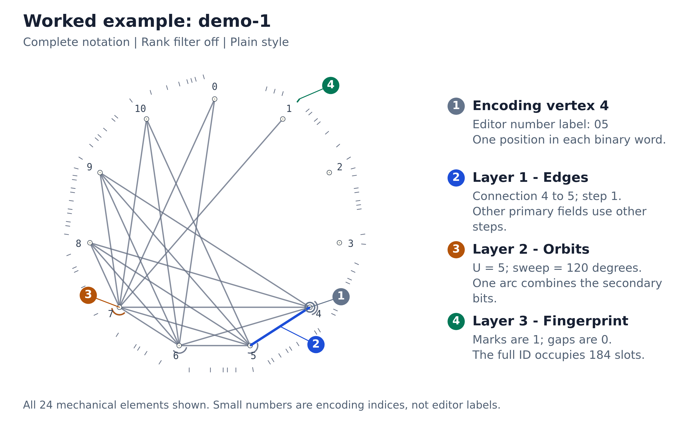

Sigil generates drawings that encode nine mechanical attributes of a
Pathfinder Second Edition spell and its source / variant ID. The annotated
example below shows the complete encoding before rank-based display filtering.

{#fig-calculation-example fig-alt="Annotated sigil showing vertex 4, the Rank edge from 4 to 5, a 120-degree orbit, and the outer spell fingerprint marks."}

Representing every attribute as an edge between two vertices produced
crowded drawings. The notation therefore separates five primary attributes into
edge families and four secondary attributes into vertex-centered orbits.
A third layer stores the ID because different spells can share the same
mechanical attributes.

The layers in @fig-calculation-example correspond to the editor's Notation
panels:

| Layer | On the canvas | Encodes |
|---|---|---|
| 1 - Edges | Connections between numbered vertices | Five primary attributes |
| 2 - Orbits | An arc or ring around a vertex | Four secondary attributes |
| 3 - Spell fingerprint | Ordered marks and gaps | Source / variant ID |

Sigil is an independent adaptation of [*The Spell Writing Guide*](https://www.gorillaofdestiny.com/books-and-compendiums)
and [SpellWriting](https://github.com/GorillaOfDestiny/SpellWriting), by The Gorilla
of Destiny. Vertex-centered orbits, the fingerprint, and rank-based filtering
are Sigil extensions. This reference does not require the original guide.

## Spell data and preprocessing

The bundled spell catalogue comes from
[fyjham-ts/Pathfinder-2E-Spell-DB](https://github.com/fyjham-ts/Pathfinder-2E-Spell-DB).
Removing one duplicate record each for Light, Invisibility, and Clairvoyance
reduced the original 1,403 records to 1,400. Each record retains its description,
source book and page, and `nethysUrl` linking to
[Archives of Nethys](https://2e.aonprd.com/Spells.aspx). Local and hosted
builds bundle the same full catalogue.

On import, the parser normalizes raw fields into rank, exact tradition
combinations, damage, area, range, casting time, duration, Primary Trait, and
casting traits. Descriptions and publication references remain separate from
the encoded categories.

The parser uses the first nonempty identifier from `variant`, `sourceId`,
`uuid`, `_id`, `id`, `slug`, or an object key. If none is available, it falls
back to the Archives of Nethys page ID, for example `aon-1662`, or generates
a content-based ID if that is also missing. IDs are shortened and
disambiguated as needed.

## From fields to bits

For $m$ primary attributes, the implementation selects the vertex count as

$$
n = \operatorname{nextPrime}(2m+1) = 11.
$$ {#eq-vertex-count}

Here $m = 5$, and `nextPrime` selects the smallest prime at least as large as
$2m+1$. At eleven vertices, steps 1 through 5 define distinct undirected
edge families; steps 6 through 10 repeat them in reverse. No vertex pair
therefore belongs to two attribute families. A prime vertex count also ensures
that all nonconstant binary necklaces have the same number of distinct rotations.

Both mechanical layers use eleven-bit binary words indexed from `0` to `10`,
left to right. A set bit activates its vertex. The editor's optional number labels use
`01` to `11` for the same positions, as illustrated in @fig-calculation-example.
The value `none` bypasses the dictionary and encodes as the all-zero word.

The dictionary contains one representative per binary necklace, chosen as its
lexicographically smallest rotation. The all-zero and all-one words are
excluded. Since 11 is prime, each remaining necklace has 11 distinct rotations,
giving

$$
N = \frac{2^{11}-2}{11} = 186.
$$ {#eq-necklaces}

For the eleven-vertex layout, representatives with Hamming weight $w$ are
sorted by increasing distance $\lvert w-4\rvert$, with lexicographic
tie-breaking. This heuristic favors four active bits to reduce visual clutter.
For an option at zero-based index $q$ in its attribute's ordered list,
excluding `none`, the encoder selects dictionary entry $q$ and rotates it left by

$$
r(q) = (7q+3)\bmod 11.
$$ {#eq-rotation}

Necklaces keep option codes distinct under cyclic shifts. Based on how the
generated sigils look, we shift the bits so some available options use vertex
`0`, which would otherwise never be active because every dictionary word starts
with `0`. This is a visual preference, not a guarantee of even spacing.

The simplified rotation in @eq-rotation applies to the shipped eleven-vertex
layout. Reproduction requires the same dictionary and option ordering, including
Range choices appended from a catalogue. A tradition subset such as
`Arcane+Primal` occupies one option.

## Calculate the layers

### Layer 1 - Edges

Each primary attribute is assigned an edge step $k$:

| Attribute | Step $k$ |
|---|---:|
| Rank | 1 |
| Tradition | 2 |
| Range | 3 |
| Duration | 4 |
| Primary Trait | 5 |

Each active bit at vertex index $i$ contributes the undirected edge

$$
\{i,\ (i+k)\bmod 11\}.
$$ {#eq-edge}

With the vertex count from @eq-vertex-count, the five families in @eq-edge
partition all $11 \cdot 10 / 2 = 55$ vertex pairs without overlap.

### Layer 2 - Orbits

Let $b_{a,i}$ denote attribute $a$'s bit at vertex $i$. The four secondary
attributes determine an orbit value $U_i$ and sweep angle $\theta_i$:

$$
\begin{aligned}
U_i &= b_{\text{Damage},i} + 2b_{\text{Area},i}
     + 4b_{\text{Casting time},i} + 8b_{\text{Casting traits},i},\\
\theta_i &= \frac{360^\circ U_i}{15} = 24^\circ U_i.
\end{aligned}
$$ {#eq-orbit}

The power-of-two weights in @eq-orbit distinguish all sixteen bit combinations.
$U_i = 0$ produces no orbit, $1 \leq U_i \leq 14$ a partial arc, and $U_i = 15$
a complete 360-degree circle. A complete circle occurs only when all four
secondary bits are active at the same vertex.

### Layer 3 - Spell fingerprint

The fingerprint payload is `["spell-id", variant]` serialized as compact JSON,
with the source / variant ID represented as a string, or the empty string if absent.
Its UTF-8 bytes are prefixed by their count as an unsigned 16-bit integer.
The header and payload bytes are written most significant bit first. For a
payload of $B$ bytes, the fingerprint length in bits is

$$
L = 16 + 8B,\qquad B \leq 192.
$$ {#eq-fingerprint}

The 192-byte limit in @eq-fingerprint is an implementation constraint intended
to keep the fingerprint legible. It applies to the complete payload, not the
ID alone. Each bit occupies a marker slot: `1` is marked and `0` remains
unmarked. This layer stores the ID rather than a name or mechanics hash;
reusing an ID produces the same fingerprint.

## What the editor displays {#what-the-editor-displays}

The editor enables Filter details by rank by default. Applied after complete
encoding and before rendering, it retains all $R$ Rank edges and the complete
fingerprint. The remaining edges and whole orbits form an optional pool of
size $M$. For display fraction $f$, the visible mechanical count is

$$
V = R + \lceil fM\rceil.
$$ {#eq-visibility}

In @eq-visibility, $f$ is 20% for cantrips, 40% for ranks 1-3, 60% for 4-6,
80% for 7-8, and 100% for 9-10. Disabling the filter sets $f = 1$, as in
@fig-calculation-example. Optional elements are selected in round-robin order
from Tradition, Orbits (sorted by vertex), Range, Duration, and Primary Trait,
skipping exhausted pools. Orbits are selected intact; filtering never changes
their sweep angles.

The renderer fits the complete geometry to the chosen contour before drawing
the visible subset. Curvature, orbit size, colors, ink treatment, and marker
shape affect appearance rather than encoded data. Hidden elements remain in
the complete representation, but a filtered or styled image is not guaranteed
to support lossless decoding.

## Worked example

The fictional spell in @fig-calculation-example uses the following attribute
values. Its attribute names match the editor's Notation controls; `none`
indicates no selected value.
The results trace Acid through the dictionary and rotation, then summarize
the complete encoding and cantrip-filtered view. Arrays are in vertex order.

:::: {#worked-example-tables}
::: {}
<!-- worked-example-input -->
| Attribute | Value |
|---|---|
| Spell rank | cantrip |
| Tradition | Arcane |
| Range category | Self |
| Duration | Instant |
| Primary trait | Healing |
| Damage type | Acid |
| Area shape | none |
| Casting time | 1 action |
| Casting traits | none |
| Source / variant ID | demo-1 |
<!-- /worked-example-input -->

<details>
<summary>Full fingerprint bit sequence</summary>

The sequence encodes `["spell-id","demo-1"]`. The first line is the length
header; subsequent lines contain payload bytes. Whitespace is not encoded.

```{.text #worked-example-fingerprint}
0000000000010101
01011011 00100010 01110011
01110000 01100101 01101100
01101100 00101101 01101001
01100100 00100010 00101100
00100010 01100100 01100101
01101101 01101111 00101101
00110001 00100010 01011101
```

</details>

:::
::: {}
<!-- worked-example-results -->
| Property | Result |
|---|---|
| Option index (Acid) | `0` |
| Dictionary entry | `"00000001111"` |
| Left rotation | `3` |
| Non-none bits | `"00001111000"` |
| None bits | `"00000000000"` |
| Active vertices | `[4, 5, 6, 7]` |
| Rank edges | `4` |
| Other edges | `16` |
| Orbits | `4` |
| Orbit units | `[5, 5, 5, 5]` |
| Orbit sweeps (degrees) | `[120, 120, 120, 120]` |
| Fingerprint payload bytes | `21` |
| Fingerprint bits | `184` |
| Optional elements | `20` |
| Optional elements shown | `4` |
| Visible mechanical elements | `8` |
| Total mechanical elements | `24` |
<!-- /worked-example-results -->
:::
::::

### Follow the calculation

1. Acid is the first non-`none` Damage option, so $q = 0$. Dictionary entry `0`
   is `00000001111`. Using @eq-rotation gives $r(0) = 3$, producing
   `00001111000` and active vertex indices `4, 5, 6, 7`. Every other non-`none`
   selection in this example also has index `0` and receives the same word.
2. Applying @eq-edge at each active vertex index produces one edge per primary
   attribute. Rank has $k = 1$, yielding 4 to 5, 5 to 6, 6 to 7, and 7 to 8.
   The four other families contribute sixteen further edges.
3. Damage and Casting time contribute `1` and `4` at each active vertex;
   Area and Casting traits contribute zero. By @eq-orbit, each of the four
   orbits has $U_i = 1 + 4 = 5$ and a sweep of $5 \cdot 24 = 120$ degrees.
4. With $R = 4$, $M = 16 + 4 = 20$, and cantrip display fraction $f = 0.2$,
   @eq-visibility gives $V = 4 + \lceil 0.2 \cdot 20\rceil = 8$ visible mechanical
   elements out of 24. The 21-byte fingerprint payload gives
   $L = 16 + 8 \cdot 21 = 184$ fingerprint bits by @eq-fingerprint, unaffected
   by filtering.

## Select optimal attributes for Pathfinder spells {#attribute-optimization}

Seven attributes were selected manually, and two were selected through an
exhaustive search. Rank, Tradition, Damage, Area, Range, Casting time, and
Duration were chosen as mechanics worth representing.
The search then identified the two additional attributes that distinguished
the most spells when combined with those seven.

Using the original 1,403 records, the search tested all 21 pairs from
spell type, defense, targets, rarity, Primary Trait, Casting traits, and
heightening. For comparison, it also tested 2,002 unrestricted nine-of-fourteen
combinations. The search maximizes the number of uniquely identified spells,
then minimizes matching pairs, then maximizes distinct combinations. Remaining
ties are resolved lexicographically by the ordered list of attribute identifiers.

Comparison uses only the selected categorical values, excluding name, edition,
ID, and description:

- The "Spells with a unique combination" column counts spells whose attribute
  combination appears exactly once in the analysed catalogue.
- The "Combinations found" column counts the different attribute combinations
  observed in the catalogue, including shared ones, rather than the theoretical
  number of possible combinations.
- The "Pairs sharing a combination" column counts pairs of spells with identical
  attribute combinations, counting each pair once.

Three spells sharing one combination contribute one observed combination and
three matching pairs, but no uniquely identified spells.
Uniqueness is measured within this catalogue, not guaranteed for future or
custom spells.

| Attributes | Spells with a unique combination | Combinations found | Pairs sharing a combination |
|---|---:|---:|---:|
| Required seven | 1,098 | 1,222 | 307 |
| Seven + heightening | 1,215 | 1,294 | 170 |
| Seven + Primary Trait + Casting traits (selected) | 1,288 | 1,338 | 87 |
| Seven + Casting traits + heightening | 1,287 | 1,340 | 76 |
| Best unrestricted nine | 1,332 | 1,362 | 55 |
| All fourteen | 1,352 | 1,374 | 38 |

Adding Primary Trait and Casting traits uniquely identifies 91.8% of spells
in this dataset. Casting traits plus heightening produces fewer matching pairs
but identifies one fewer spell uniquely. The unrestricted nine-attribute optimum
omits required Damage, Area, and Range and is therefore ineligible. Even all
fourteen attributes leave mechanically indistinguishable records, motivating the
separate ID fingerprint.
